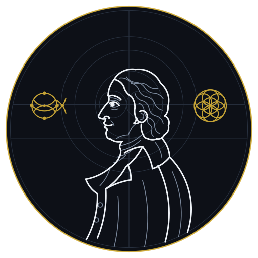

.. container:: author-overline

   semantic digital archive • the works of

==================
Lorenzo Mascheroni
==================

**Lorenzo Mascheroni** (1750–1800) posed an astonishing challenge in 1797: throw away the straightedge and build all of Euclidean geometry with the **compass alone**. Dedicated to Napoleon Bonaparte, *La Geometria del Compasso* constructs perpendiculars, golden sections, regular polygons, square roots, and even the famous four-arc problem of finding a circle's center using nothing but intersecting circular arcs.

Books in This Collection
------------------------

.. container:: home-book-hero

   .. container:: home-book-thumb

      .. image:: geometria_del_compasso/05-book-05/02-sec-93-fourth-prop/0073.g1.png
         :alt: Lorenzo Mascheroni Fig. 39 Fourth Proportional by Compass Alone (1901 chalkboard plate)
         :target: geometria_del_compasso/index.html

   .. container:: home-book-body

      .. rubric:: Pavia 1797 / Palermo 1901 · 12 Books · 55 Leaves · §§ 1–280

      **The Geometry of the Compass** (*La Geometria del Compasso*) — Complete 12-book edition across **English · Italian · Summary · Notes** tracks, featuring **85 cropped chalkboard plates** from Fazzari's 1901 centenary edition, **16 calibrated interactive SVGs**, and full cross-references to Georg Mohr and Émile Lemoine.

      .. container:: home-actions

         * :doc:`Open La Geometria del Compasso → <geometria_del_compasso/index>`
         * :doc:`Book V (Proportional Distances) → <geometria_del_compasso/05-book-05/index>`
         * :doc:`Book X (Napoleon's Problem) → <geometria_del_compasso/10-book-10/index>`
         * :doc:`Symbolic Demos → <demos/index>`

Key Features
------------

.. container:: home-feature-grid

   .. container:: home-feature-card

      **The Mohr–Mascheroni Theorem in Action**

      Construct midpoints, fourth proportionals, golden sections, square roots, line–circle intersections, and Platonic polyhedral chords using circular arcs alone.

   .. container:: home-feature-card

      **85 Chalkboard Plates & Four-Track Codex**

      Compare Gaetano Fazzari's 1901 Italian centenary edition alongside direct English translation, summaries, and notes linking Carette's 1798 French translation.

   .. container:: home-feature-card

      **Lemoine & Steiner Duality**

      Trace how Mascheroni's compass-only constructions compare in geometrographic simplicity against Poncelet–Steiner's straightedge-plus-one-circle constructions.

Reference & Project
-------------------

.. container:: home-columns

   .. container:: home-col

      .. rubric:: Scholarly Apparatus

      * :doc:`People <people/index>` — Profiles of Lorenzo Mascheroni, Georg Mohr, Gaetano Fazzari, Antoine-Michel Carette, and Napoléon Bonaparte
      * :doc:`Bibliography <bibliography>` — 1797 Pavia, 1798 Paris, and 1901 Palermo primary witnesses
      * :doc:`Glossary <glossary>` — Italian, French, and English operational terms in compass-only geometry

   .. container:: home-col

      .. rubric:: About This Project

      * :doc:`About <about/index>` — Editorial scope, archival provenance, and symbolic architecture
      * :doc:`Using This Edition <usage/index>` — Track switching, folio links, and navigation guide
      * :doc:`Log <log/index>` & :doc:`Modules <modules/index>` — Development journal and Python API reference

.. toctree::
   :maxdepth: 2
   :hidden:

   geometria_del_compasso/index
   people/index
   bibliography
   glossary
   about/index
   usage/index
   demos/index
   modules/index
   log/index
